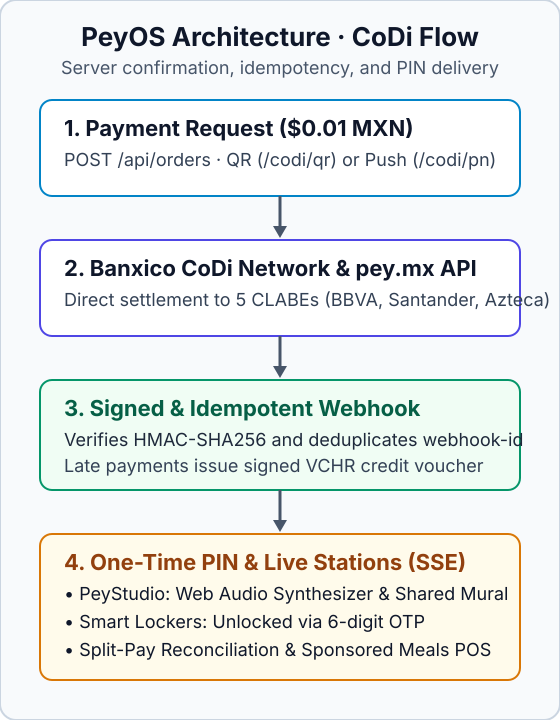

# Hackaton_Grok_Prey (PeyOS Live)

[Español](README.md) · **English**

Real-time transactional orchestrator for CoDi micropayments ($0.01 MXN) featuring cryptographic webhook verification, a smart locker digital twin, a collaborative Web Audio synthesizer studio, and multi-CLABE bill reconciliation built on the [pey.mx](https://docs.pey.mx) API.

> **Notice:** Production tests on the Mexican CoDi network settle real bank transfers and are non-refundable by Banxico. Use `$0.01 MXN` amounts during live testing.

<picture>
  <source media="(prefers-color-scheme: dark)" srcset="docs/assets/arquitectura.en.dark.svg">
  
</picture>

## What you can do

- **Trigger a live Web Audio synthesizer, shared mural, and interactive story for $0.01 MXN**: generate a CoDi QR (`/codi/qr`) or send a 10-digit mobile push request (`/codi/pn`) to the `synth` station to activate 8-step sequencer tracks and paint a tile on the shared canvas.
- **Unlock smart lockers and timed pods with a single-use PIN**: pay $0.01 MXN on the `locker` station; once the server verifies the webhook, it issues a 6-digit OTP PIN and only releases the digital latch after `verifyDeliveryOtp` succeeds.
- **Split bills across multiple banks without manual receipt tracking**: the `split` station routes individual $0.01 MXN charges across BBVA (`012`), Santander (`014`), and Banco Azteca (`127`) accounts, reconciling each share automatically via `numRef`.
- **Fund and redeem sponsored meals with zero fake screenshots**: the `meals` / `pos` station separates funded meals from delivered meals and requires the one-time PIN at counter handoff.
- **Audit financial edge cases in one click**: the engineering console lets judges test duplicate webhook replays (idempotency), late payments after expiration (signed `VCHR-*` credit voucher issuance), bank rejections with automatic multi-CLABE failover, and forged HMAC signatures (`401`).

## How it works

1. **CLABE check-digit validation**: [`src/config/clabes.js`](src/config/clabes.js) (`validateClabe`, `computeClabeCheckDigit`) verifies the 18 digits and Banxico's modulo-10 (`3-7-1` weight) check digit for all 5 pre-authorized hackathon accounts and any newly registered account.
2. **CoDi QR and Push creation**: [`src/services/peyClient.js`](src/services/peyClient.js) (`createCodiQr`, `createCodiPushNotification`, `registerBankAccount`) calls `https://api.pey.mx` with Bearer authentication and renders scannable QR codes or sends push requests.
3. **Standard Webhooks verification and idempotency**: [`src/services/peyClient.js`](src/services/peyClient.js) (`verifyStandardWebhook`) verifies the `HMAC-SHA256` signature over `${webhookId}.${timestamp}.${rawBody}`, while [`src/engine/peyEngine.js`](src/engine/peyEngine.js) (`processWebhook`) deduplicates every `webhook-id` and `transactionId`.
4. **Payment vs. delivery separation and late payment compensation**: [`src/engine/peyEngine.js`](src/engine/peyEngine.js) (`processWebhook`, `verifyDeliveryOtp`, `triggerBankRejectionAndFailover`) issues a single-use OTP when paid on time, generates a signed voucher if a payment arrives after expiration, and fails over across banks on rejection.
5. **Real-time state streaming**: [`src/server.js`](src/server.js) (`createAppServer`) serves the REST endpoints and broadcasts every state change to connected clients over Server-Sent Events (`GET /api/events`).

## Quickstart

Requires Node.js `>= 20.0.0` and npm.

```sh
cp .env.example .env
npm install
npm test
npm start
```

Open `http://localhost:3000`. The **SSE Tiempo Real** indicator will light up green, displaying all 4 interactive stations and the webhook engineering console.

## Pre-authorized test CLABE accounts ($0.01 MXN)

| Account Holder | CLABE (18 digits) | Bank | Role in PeyOS |
| --- | --- | --- | --- |
| Ramón Orraca | `012180015826225713` | BBVA México (`012`) | PeyStudio: Collaborative Audio & Canvas |
| Santiago Tena | `012180015913466252` | BBVA México (`012`) | Smart Lockers & Timed Pods |
| Adrian Soto | `014180606004536217` | Santander México (`014`) | Split-Pay & Automated Reconciliation |
| Miriam Nava | `012180015355682429` | BBVA México (`012`) | Point of Sale (POS) & PIN Delivery |
| David Perez | `127180016558860385` | Banco Azteca (`127`) | Sponsored Meals & Multi-Bank Failover |

## Optional extras

| Extra | Purpose | Requirements | Guide |
| --- | --- | --- | --- |
| Live `api.pey.mx` connection | Issue live CoDi QRs and mobile push notifications | `PEY_API_KEY` and `PEY_WEBHOOK_SECRET` from [portal.mipey.mx](https://portal.mipey.mx) | Click **Configurar API Key Pey** in the top bar or set variables in `.env` |
| Docker / Render deployment | Deploy the server with state persistence and SSE | Docker or Render/Railway account | [`Dockerfile`](Dockerfile) and [`render.yaml`](render.yaml) |

## Structure

| Directory | Contents |
| --- | --- |
| `src/config/` | SPEI/CoDi bank catalog, the 5 pre-authorized CLABEs, and Banxico check-digit validator |
| `src/services/` | HTTP client for `api.pey.mx`, QR generator, and Standard Webhooks (`HMAC-SHA256`) signer/verifier |
| `src/engine/` | Deterministic state machine, idempotency, OTP issuance, late-payment vouchers, and multi-CLABE failover |
| `src/` | HTTP server and Server-Sent Events stream (`/api/events`, `/api/webhooks/pey`, `/codi/pn`) |
| `public/` | Web UI with Web Audio synthesizer, smart locker digital twin, Split-Pay board, and webhook inspector |
| `test/` | Integration, webhook cryptography, idempotency, and business rule test suite |
| `docs/` | Architecture diagrams (`docs/assets/`) and Architecture Decision Records (`docs/adr/`) |

## Tests

```sh
npm test
```

## Decisions

- [ADR 0001: Idempotent CoDi orchestration and payment-delivery separation via OTP PIN](docs/adr/0001-orquestacion-codi-idempotente-y-entrega-otp.md) (in Spanish)

## Credits

- CoDi API and documentation: [pey.mx](https://docs.pey.mx) and [Standard Webhooks](https://www.standardwebhooks.com/).
- Diagram layered with [legibify](https://github.com/G10hdz/legibify).

## License

[MIT](LICENSE).
