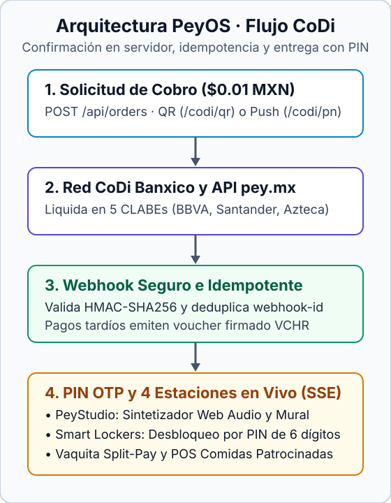

# Hackaton_Grok_Prey (PeyOS Live)

**Español** · [English](README.en.md)

Orquestador transaccional en tiempo real para cobros CoDi ($0.01 MXN) con verificación criptográfica de webhooks, gemelo digital de casilleros inteligentes, estudio musical colectivo y conciliación multi-CLABE construido con la API de [pey.mx](https://docs.pey.mx).

> **Aviso:** Las pruebas en producción sobre la red CoDi liquidan transferencias reales entre cuentas bancarias y no son reembolsables por Banxico. Utiliza montos de `$0.01 MXN` durante las pruebas.

<picture>
  <source media="(prefers-color-scheme: dark)" srcset="docs/assets/arquitectura.es.dark.svg">
  
</picture>

## Qué puedes hacer

- **Activar un sintetizador Web Audio, un mural colectivo y una historia interactiva por $0.01 MXN**: genera un QR CoDi (`/codi/qr`) o envía una notificación push al celular (`/codi/pn`) hacia la estación `synth` para encender pistas del secuenciador de 8 pasos y pintar una baldosa con dedicatoria.
- **Desbloquear casilleros y cabinas de tiempo con PIN de un solo uso**: paga $0.01 MXN en la estación `locker`; el servidor confirma el webhook, emite un PIN OTP de 6 dígitos y solo abre la cerradura digital cuando se valida ese PIN en `verifyDeliveryOtp`.
- **Dividir una cuenta entre varios bancos sin sumar comprobantes a mano**: la estación `split` distribuye cobros individuales entre cuentas de BBVA (`012`), Santander (`014`) y Banco Azteca (`127`), conciliando cada aportación por `numRef`.
- **Financiar y entregar comidas patrocinadas sin capturas falsas**: la estación `meals` / `pos` separa las comidas financiadas de las entregadas y exige el PIN OTP al momento de despachar en mostrador.
- **Auditar casos borde financieros en un clic**: la consola de ingeniería permite probar webhooks duplicados (idempotencia), pagos tardíos tras expiración (emisión de voucher firmado `VCHR-*`), rechazos bancarios con failover automático a otra CLABE y firmas HMAC inválidas (`401`).

## Cómo funciona

1. **Validación de cuentas CLABE**: [`src/config/clabes.js`](src/config/clabes.js) (`validateClabe`, `computeClabeCheckDigit`) verifica los 18 dígitos y el dígito verificador de Banxico (ponderación `3-7-1`) para las 5 cuentas pre-autorizadas del hackatón y cualquier cuenta nueva.
2. **Emisión de cobros QR y Push CoDi**: [`src/services/peyClient.js`](src/services/peyClient.js) (`createCodiQr`, `createCodiPushNotification`, `registerBankAccount`) conecta con `https://api.pey.mx` usando autenticación Bearer y genera el código QR escaneable o la solicitud push a 10 dígitos.
3. **Verificación Standard Webhooks e idempotencia**: [`src/services/peyClient.js`](src/services/peyClient.js) (`verifyStandardWebhook`) valida la firma `HMAC-SHA256` sobre `${webhookId}.${timestamp}.${rawBody}` y [`src/engine/peyEngine.js`](src/engine/peyEngine.js) (`processWebhook`) bloquea cualquier `webhook-id` o `transactionId` repetido.
4. **Separación de pago y entrega más manejo de pagos tardíos**: [`src/engine/peyEngine.js`](src/engine/peyEngine.js) (`processWebhook`, `verifyDeliveryOtp`, `triggerBankRejectionAndFailover`) emite el PIN OTP cuando el pago llega en tiempo, genera un voucher criptográfico si el pago llega tarde y conmuta de banco en caso de fallo.
5. **Streaming en tiempo real**: [`src/server.js`](src/server.js) (`createAppServer`) expone la API REST y transmite cada transición de estado a todas las pantallas conectadas mediante Server-Sent Events (`GET /api/events`).

## Lo mínimo

Necesitas Node.js `>= 20.0.0` y npm.

```sh
cp .env.example .env
npm install
npm test
npm start
```

Abre `http://localhost:3000`. Verás el indicador **SSE Tiempo Real** en verde, las 4 estaciones interactivas y la consola de webhooks lista para recibir pagos reales o ejecutar pruebas del jurado.

## Cuentas CLABE pre-autorizadas para pruebas ($0.01 MXN)

| Titular | CLABE (18 dígitos) | Institución | Rol en PeyOS |
| --- | --- | --- | --- |
| Ramón Orraca | `012180015826225713` | BBVA México (`012`) | PeyStudio: Audio Colectivo y Lienzo |
| Santiago Tena | `012180015913466252` | BBVA México (`012`) | Smart Lockers y Cabinas de Tiempo |
| Adrian Soto | `014180606004536217` | Santander México (`014`) | Vaquita Split-Pay y Conciliación |
| Miriam Nava | `012180015355682429` | BBVA México (`012`) | Punto de Venta (POS) y Entregas con PIN |
| David Perez | `127180016558860385` | Banco Azteca (`127`) | Comedor Solidario y Respaldo Multi-Banco |

## Extras opcionales

| Extra | Para qué | Necesita | Guía |
| --- | --- | --- | --- |
| Conexión en vivo con `api.pey.mx` | Emitir QRs y notificaciones Push CoDi reales | `PEY_API_KEY` y `PEY_WEBHOOK_SECRET` de [portal.mipey.mx](https://portal.mipey.mx) | Botón **Configurar API Key Pey** en la barra superior o variables en `.env` |
| Contenedor Docker / Render | Desplegar el servidor con persistencia y SSE | Docker o cuenta en Render/Railway | [`Dockerfile`](Dockerfile) y [`render.yaml`](render.yaml) |

## Estructura

| Carpeta | Qué hay dentro |
| --- | --- |
| `src/config/` | Catálogo de bancos SPEI/CoDi, las 5 CLABEs pre-autorizadas y validador del dígito verificador de Banxico |
| `src/services/` | Cliente HTTP para `api.pey.mx`, generador de QR y firmador/verificador Standard Webhooks (`HMAC-SHA256`) |
| `src/engine/` | Máquina de estados determinista, idempotencia, emisión de OTP, vouchers por pago tardío y failover multi-CLABE |
| `src/` | Servidor HTTP y canal Server-Sent Events (`/api/events`, `/api/webhooks/pey`, `/codi/pn`) |
| `public/` | Interfaz web con sintetizador Web Audio API, gemelo digital de casilleros, Vaquita Split-Pay y consola de webhooks |
| `test/` | Pruebas de integración, criptografía de webhooks, idempotencia y reglas de negocio |
| `docs/` | Diagramas de arquitectura (`docs/assets/`) y registros de decisión de arquitectura (`docs/adr/`) |

## Tests

```sh
npm test
```

## Decisiones

- [ADR 0001: Orquestación CoDi idempotente y separación de pago y entrega mediante PIN OTP](docs/adr/0001-orquestacion-codi-idempotente-y-entrega-otp.md)

## Créditos

- Documentación e infraestructura CoDi: [pey.mx](https://docs.pey.mx) y estándar [Standard Webhooks](https://www.standardwebhooks.com/).
- El diagrama sigue el modelo de capas de [legibify](https://github.com/G10hdz/legibify).

## Licencia

[MIT](LICENSE).
